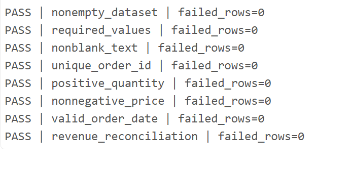
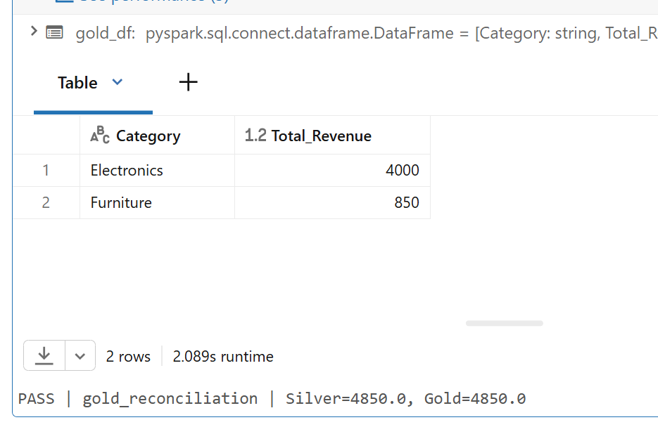
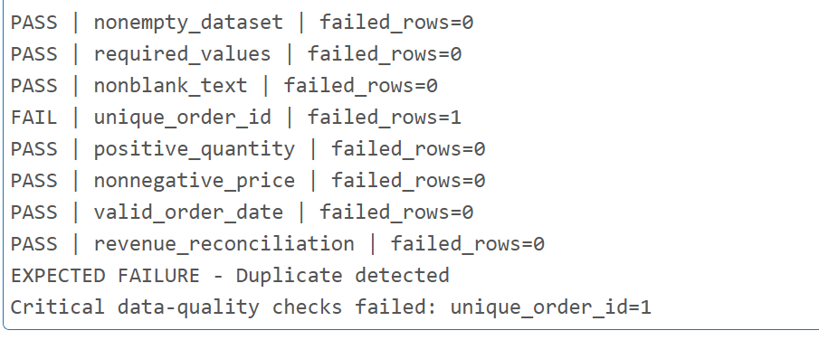
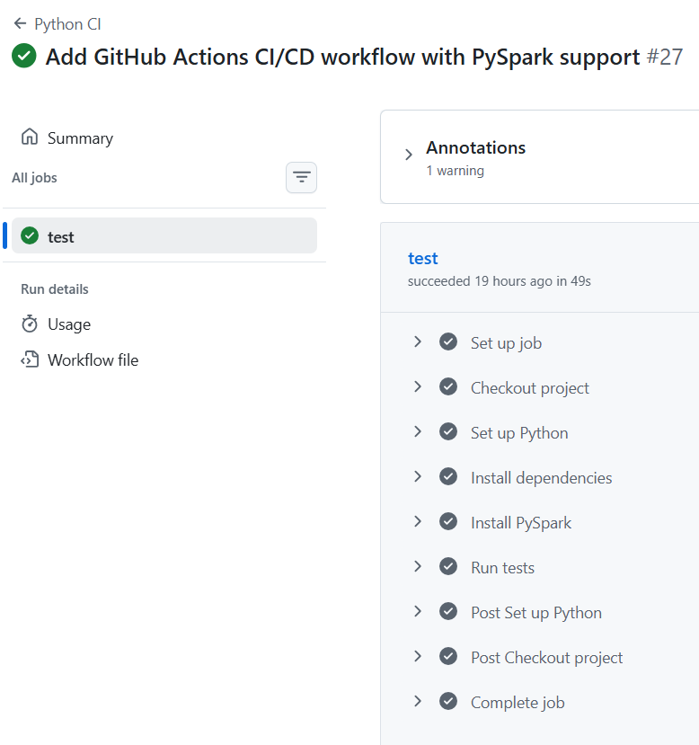
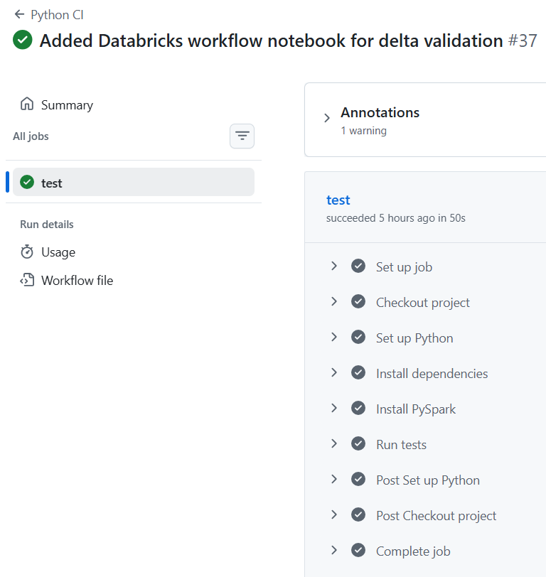
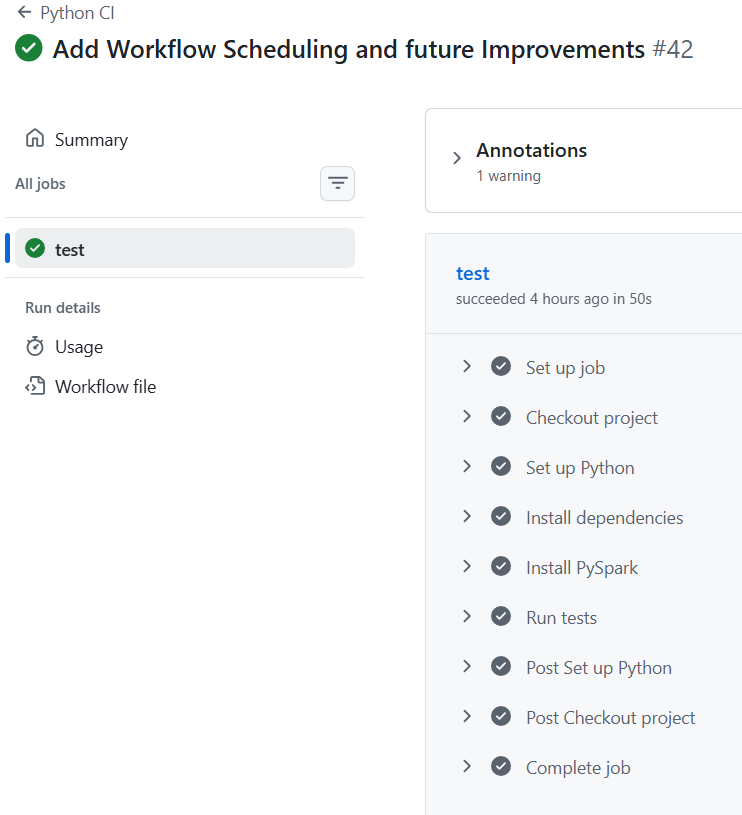
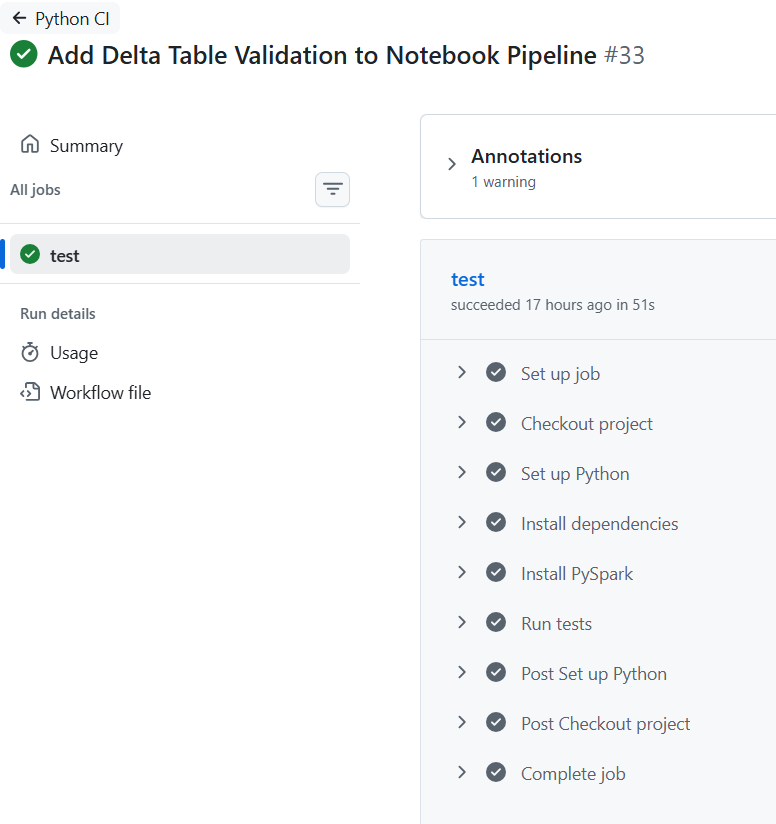

# Databricks Retail Sales ETL — PySpark, Delta Lake, CI/CD

**Project owner:** HeeJung Kim  
**Repository focus:** Batch retail-sales transformations, testable data-quality gates, Delta tables, and GitHub Actions.

## Project overview

This project contains two implementations of a retail-sales Bronze–Silver–Gold pattern:

- **Databricks / PySpark:** reads raw CSV data from a Unity Catalog Volume, casts numeric fields, calculates revenue, validates the Silver dataset, aggregates category revenue, and writes Silver and Gold Delta tables.
- **Local Python / Pandas:** reads the repository's sample CSV and produces Silver and Gold CSV outputs. This is a separate local demonstration, not the Delta publishing path.

The PySpark implementation uses reusable quality checks in [pipelines/data_quality.py](pipelines/data_quality.py) instead of relying only on static assertions.

## Architecture

```text
Retail sales CSV in Unity Catalog Volume (raw Bronze source)
                        |
                        v
                PySpark Silver transform
                        |
                        v
        Data-quality gate: FAIL on critical errors
         | required fields | duplicates |
         | valid numbers   | valid dates |
         | quantity/price  | revenue     |
                        |
                        v
            Gold: revenue by category
                        |
                        v
               Gold revenue reconciliation
                        |
                        v
              Delta Silver + Gold writes
                        |
                        v
              Validate output row counts

GitHub Actions -> pytest (local Spark tests) -> JUnit XML artifact
Databricks Workflows -> Databricks notebook execution (configure in workspace)
```

**Note:** Raw Bronze CSV is not persisted as a Bronze Delta table in this implementation. Silver and Gold are Delta tables. Silver and Gold writes are sequential, not a multi-table atomic transaction. The notebook requires the checked-out repository and a working source Volume.

## Repository map

| Path | Purpose |
| --- | --- |
| `notebooks/bronze_to_silver_notebook.py` | Databricks batch ETL with pre-write validation |
| `notebooks/bronze_to_silver_notebook.ipynb` | Notebook-format version of the same pipeline |
| `pipelines/data_quality.py` | Reusable Silver transforms, validation rules, and Gold reconciliation |
| `pipelines/etl_pipeline.py` | Separate Pandas/CSV ETL demonstration |
| `tests/test_data_quality.py` | PySpark DataFrame positive and negative tests |
| `tests/test_pipeline.py` | Earlier static unit tests retained for historical context |
| `.github/workflows/python-ci.yml` | Automated pytest and JUnit artifact upload |
| `docs/data_quality.md` | Rules, limitations, and evidence plan |

## Data-quality checks

| Check | Policy |
| --- | --- |
| Nonempty dataset | At least one Silver record |
| Required columns and values | Fail on absent columns or null values, including failed numeric casts |
| Nonblank fields | Fail on blank ID, Product, Category, or OrderDate |
| Unique OrderID | Fail on duplicate order identifiers |
| Quantity | Must be greater than zero |
| Price | Must be nonnegative |
| OrderDate | Must be castable to a date |
| Revenue | `Quantity * Price`, within 0.01 absolute tolerance |
| Gold totals | Sum of Gold category revenue matches Silver revenue, within 0.01 |

A failed critical check raises `DataQualityError` and prevents the notebook from starting Delta output writes. Results print `PASS` or `FAIL` with failed-row counts.

These are **validation gates**, not a persisted historical monitoring system or alerting dashboard.

## Running tests

With Python 3.11 and a compatible Java runtime:

```bash
python -m pip install -r requirements.txt
python -m pytest -q --junitxml=pytest-results.xml
```

The CI workflow configures Java 17, installs requirements, runs these tests, and uploads `pytest-results.xml` as the `pytest-results` artifact. Check the [Actions tab](../../actions) for actual results; a successful screenshot from an older workflow does not establish that the new quality checks have passed.

## Databricks execution

1. Clone or sync this project into a Databricks Git folder.
2. Confirm the source CSV exists at `/Volumes/retail_sales_catalog/default/bronze_data/sales_data.csv`.
3. Ensure you have permissions to write `retail_sales_catalog.default.silver_sales` and `retail_sales_catalog.default.gold_sales_summary`.
4. Run `notebooks/bronze_to_silver_notebook.py` or its `.ipynb` counterpart on compatible compute.
5. Review the data-quality output, Gold reconciliation, Delta table row counts, and Databricks Workflow status.

A scheduled Workflow and failure notifications are workspace configuration; repository code alone cannot prove their current configuration. Existing screenshots show prior runs, not necessarily this upgraded code.

## Validation evidence

### New: Databricks quality-validation run (October 28, 2026)

A separate read-only Databricks notebook loaded five sample sales records from the Unity Catalog Volume. It validated the in-memory Silver and Gold DataFrames without overwriting the existing Delta tables.

**Silver validation — all 8 checks passed (0 failed rows per check)**



**Gold reconciliation — Silver = 4,850; Gold = 4,850**



**Negative test — expected duplicate OrderID failure (1 invalid record detected)**



Read the [evidence notes and test scope](docs/evidence/README.md). These images show DataFrame validation and a deliberately triggered error; they do not demonstrate an actual Databricks Workflow failure or a new Delta table overwrite.

### GitHub Actions CI/CD

The updated PySpark test suite passed in [GitHub Actions run #69](https://github.com/hjkim20022/databricks-cicd-project/actions/runs/40644326091). A subsequent run on the evidence commits, [run #77](https://github.com/hjkim20022/databricks-cicd-project/actions/runs/40661734907), also completed successfully. Open a run's `pytest-results` artifact for a machine-readable JUnit report.

### Earlier Databricks screenshots (prior implementation)

The following screenshots are retained from earlier work. They should not be interpreted as proof that this upgraded notebook was scheduled or used to publish new Delta tables.

**Previous GitHub Actions run**



**Previous Databricks Workflow runs**





**Previous Delta table validation**



## Current scope and future improvements

| Capability | Status |
| --- | --- |
| Batch PySpark transforms and Silver/Gold Delta writes | Implemented in source code; validate execution in Databricks |
| PySpark quality gates and local Spark tests | Implemented; passing CI run and Databricks in-memory validation evidence linked above |
| GitHub Actions test workflow | Configured and successfully executed for the upgraded tests; see linked runs |
| Unity Catalog Volume and named tables | Referenced in code; access-control grants are not demonstrated |
| Databricks Workflows | Previous-run screenshots exist; current schedule/alerts require workspace verification |
| Auto Loader streaming | Planned separately; not implemented in this repository |
| Lakeflow Declarative Pipelines / DLT | Planned separately; not implemented in this repository |
| Unity Catalog permission / lineage evidence | Planned |
| Persisted data-quality trend monitoring / alerts | Planned |
| Real-time streaming analytics | Planned |

## Portfolio summary

Implemented a Databricks/PySpark batch retail-sales pipeline with Silver/Gold Delta output, reusable data-quality validation, revenue reconciliation, and PySpark tests integrated with a GitHub Actions CI workflow. Automated tests and read-only Databricks DataFrame validation have passed; publishing the upgraded notebook through Databricks Workflows remains to be verified.
