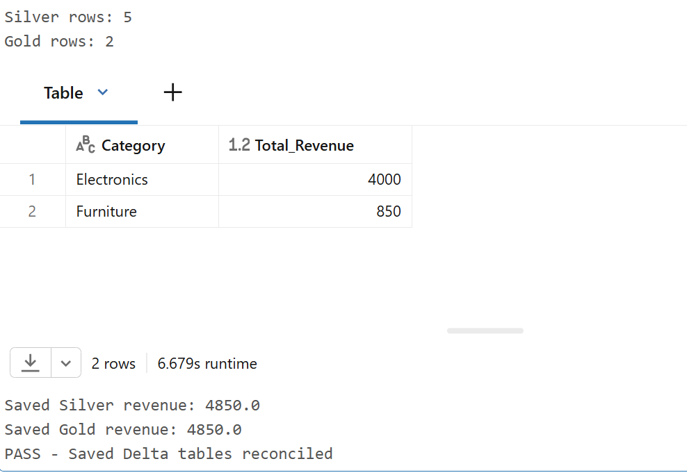

# Databricks Data Quality Validation Evidence

These screenshots document actual testing of the retail-sales PySpark pipeline in Databricks on **October 28, 2026**. Tests used five source CSV records from the Unity Catalog Volume. The full pipeline was run using **separate test Delta tables**; the original `silver_sales` and `gold_sales_summary` tables were not intentionally overwritten.

## 1. Silver data-quality checks — 8/8 passed

A separate testing notebook evaluated the Silver DataFrame in memory. All eight critical checks reported `PASS` with `failed_rows=0`.

## 2. In-memory Gold revenue reconciliation — passed

The Silver and Gold DataFrames reconciled: **Silver = 4,850.0; Gold = 4,850.0**. Category revenue was Electronics = 4,000 and Furniture = 850.

## 3. Controlled duplicate detection — expected failure

A duplicate OrderID 1001 was added **in memory only**. The `unique_order_id` check reported `failed_rows=1`, and `assert_quality` raised `DataQualityError` as designed. The test notebook caught the expected exception to display the evidence.

## 4. Persisted Delta test tables — passed

The upgraded batch notebook completed its quality checks, computed Gold, and wrote two **separate test tables** (rather than the project's original output tables):

- `retail_sales_catalog.default.silver_sales_quality_test_20261028`: **5 rows**
- `retail_sales_catalog.default.gold_sales_quality_test_20261028`: **2 rows**

An independent read of the saved Delta tables confirmed Electronics = **4,000**, Furniture = **850**, and **Silver revenue = Gold revenue = 4,850.0**. The screenshot includes the message `PASS - Saved Delta tables reconciled`.

The original notebook run also printed `PASS | delta_output_rows | silver=5, gold=2`, along with a completion message. That output was observed in Databricks, but a separate screenshot of the full run is not included here.

## CI verification and limitations

- [GitHub Actions](https://github.com/hjkim20022/databricks-cicd-project/actions) executes local PySpark tests and uploads a JUnit report. [Run #81](https://github.com/hjkim20022/databricks-cicd-project/actions/runs/40662058330) passed **23 tests** on October 28, 2026.
- The above Databricks screenshots are **separate from GitHub CI**: they prove the in-memory validation, controlled failure, and persistence/reconciliation in the isolated Delta test tables.
- This evidence **does not establish** that the updated code has been executed through a *scheduled Databricks Workflow* or that alerts and notifications are configured.
- Silver and Gold Delta writes are **sequential**, not an atomic two-table transaction. Production-style scheduling, rollback, and historical quality monitoring are future improvements.
- The committed version of `notebooks/bronze_to_silver_notebook.py` uses the original `silver_sales` and `gold_sales_summary` target names. For this safe test, those two names were changed locally to the isolated `*_quality_test_20261028` destinations; **the temporary edits were not committed**.

See [project architecture](../project_architecture.md) and [data-quality runbook](../data_quality.md).
